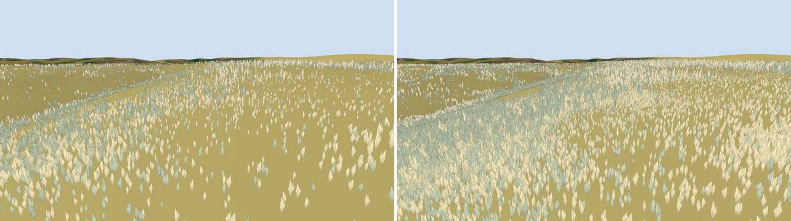

# GPU ground-cover placement: prototype

The follow-up that [webgpu-evaluation.md](webgpu-evaluation.md) recommended: place and cull the grass
on the GPU around a moving camera, standalone, on the real home tile, against grass.js's CPU
placement. Built and measured 2026-10-25. Not committed to the client. Nothing in the client imports
it, and it changed no client module.

**Verdict.**

- **It works, and it is exact.** The GPU places the same plants as grass.js, bit for bit in every
  decision. Over 2,486,786 plants in 629 cells, plus five cells picked for roads, water, outcrops
  and a rewilded meadow, the count of plants that differ is 0, and no field differs either. That
  covers all three blade tiers and all three card roles.
- **It does not make today's client faster.** At today's density the CPU cell cache costs about
  0.1 ms in a median frame. It did not stall at any speed up to 200 m/s.
- **Regenerating the full radius every frame is not cheap.** It costs 1.5-1.8 ms of GPU time a
  frame, against a cache that rarely has anything to do.
- **What it buys is headroom.**
  - **Density.** At 4x and 8x the CPU path starts to drop frames and leave cells unbuilt. The GPU
    pays about 1 ns per candidate.
  - **Tighter culling.** Per-plant culling draws about half the instances the CPU's 10 m blocks
    submit.
  - **The right design is a GPU cell cache.** Generate new cells on the GPU, as the CPU does now,
    and cull every frame. Full-radius regeneration every frame is not the design to adopt: at 8x it
    costs 7.6 ms a frame.
- **Drawing becomes the limit.** At 8x density, 126 k cards took about 3 ms to draw, even as
  4-triangle cards.



## What was built

**Files:**

- `client/gpu_place_test.html` and `client/src/gpuPlaceTest.js`: the page, the driver and the
  measurements.
- `client/src/gpuplace/wgsl.js`: the compute shaders.
- `client/src/gpuplace/cpuRef.js`: the CPU reference.

**The CPU reference is grass.js itself.** `Object.create(Grass.prototype)` runs its own `plantAt`,
`cellData`, `cardCell`, `fill` and `drain`, on the tile `loadTile` loads (utm10n_680_4280). The
constructor's meshes and atlas bake are skipped.

**Each frame, around the camera:**

1. **GEN (raw WGSL compute).**
   - The CPU lists work items: each is a cell, a layer and a rank range. This uses the client's own
     selection: `cellsAround` with each tier's placement radius (main 112 m, close 57 m, ground
     34 m), the on/off rules by height from `Grass.update`, and the card cells within 250 m
     (`ClumpField.gather`). At 3 m this is 341 items and 0.4-0.6 ms of CPU time, including uploads
     and encoding.
   - One thread runs per candidate (872 k at 3 m) and finds its item by binary search.
   - The thread runs `plantAt` as grass.js does:
     - the mulberry32 draw;
     - density × herb cover, thinned by `rockKeep` on outcrops;
     - decayed roads and their verge, then `waterAt` with its exact pond-ring and channel-segment
       test next to water;
     - bare patches, the needlegrass/annual type from the drifts, size;
     - the card role (tuft, tussock, oat), with the rank thresholds and the creek thinning.
   - The plant's ground height comes from the terrain mesh's triangles. The plant is appended in
     the client's instance layout, compacted with one global atomic per workgroup.
   - Nothing is cached: the whole radius is regenerated every frame.
2. **ARGS:** one thread turns the placed count into an indirect dispatch.
3. **CULL (raw WGSL):** one thread per placed plant.
   - Tier bands and per-plant hand-over: a blade plant that has a card fades out over the card's
     fade-in band.
   - Card bands, and the card density LOD: the lowest ranks are kept, survivors grow by
     1/sqrt(keep), as ClumpField does.
   - Frustum test.
   - Survivors are compacted into the draw buffer, and their count goes into the
     `drawIndexedIndirect` instanceCount. A one-thread pass clamps that count to capacity.
4. **DRAW (three.js r186 WebGPURenderer, TSL):**
   - One mesh of crossed cards. `geometry.setIndirect` points at the cull's count.
   - A `MeshBasicNodeMaterial` reads the draw buffer by `instanceIndex`, uses alpha-to-coverage, and
     dithers the fade with interleaved-gradient noise.

**Which API, at r186: raw WGSL for compute, TSL for the draw.**

- The compute pipelines run on the renderer's own `GPUDevice` (`renderer.backend.device`).
- The draw and indirect buffers are three.js `StorageBufferAttribute` /
  `IndirectStorageBufferAttribute` objects. The compute passes bind their `GPUBuffer`s through
  `renderer.backend.get(attribute).buffer`, an internal accessor that is stable in r186.
- Raw WGSL was chosen over TSL compute because the placement is integer hashing (u32 wraparound
  standing in for `Math.imul`), atomics and workgroup barriers. That reads one to one against
  grass.js in WGSL, and is verbose and indirect in TSL.
- The renderer is created with `requiredLimits` raising the storage-buffer count per stage (GEN binds 8, the default limit).
- Everything is submitted on the same queue before `renderer.render`, so ordering is free.

**Where it ran:**

- Headless Chrome 156 with `--enable-unsafe-webgpu` on this M1 Pro ("apple / metal-3"), 1280x720,
  4x MSAA. The driver is in the session scratchpad: `gpuplace/drive.mjs`.
- The built-in browser pane was tried in its own tab. A background tab does not run frames or
  finish adapter requests, so the pane was not used.
- The machine was contended throughout: the user's Chrome renderer at about 200% CPU, and the
  pane running the client. GPU timestamps of single passes therefore have 3-17 ms P90 spikes.
- The figures below are medians. "Wall" is 60 frames submitted back to back, then a queue fence,
  median of 7 runs: the throughput number, as in the evaluation.

## Equality with the CPU, and what it took

The check reads back every placed plant of a cell, from all four layers, with its cell, rank and
layer. It matches each one to `cellData` and `cardCell` by seed and root position, then compares
every field:

- position within 1 mm;
- height within 3 mm;
- yaw within 1e-5 rad;
- size within 2e-5;
- seed and type/tier/role code exactly.

Results: 629 cells (every 97th cell that holds grass) plus five feature cells, at density 1, and
the five feature cells at densities 2, 4 and 8. In every case: no plant missing, no plant extra, no
field out of tolerance. Every card plant is a main- or close-tier blade plant at the same place,
with the same role (0 orphans).

How the feature cells exercised the hard cases. Out of 14,941 candidates per cell (all layers):

| Cell | Kept | Density | Outcrop thinning | Road | Water | Bare patch |
|---|---|---|---|---|---|---|
| start grassland (x 4309, n 3440) | 9358 | 3039 | 14 | 0 | 0 | 2530 |
| road (pavement and verge) | 3399 | 9618 | 0 | 1496 | 0 | 428 |
| water (channel and riparian band) | 8535 | 4658 | 0 | 0 | 1230 | 518 |
| outcrop | 2325 | 10223 | 1722 | 118 | 0 | 553 |
| rewilded meadow (annual share 0.4) | 8502 | 5813 | 0 | 0 | 0 | 626 |

The three-tier rank slicing was checked per tier: main 5.5%, close 41%, ground the rest, all one
list. For the start cell that is 430 / 2718 / 4488 plants. The card roles were checked the same
way: 104 tufts, 426 tussocks and 256 oats.

**Plain f32 is not enough.** The first version matched counts to within 1 in 5,000 but was not
exact. Each fix below was found by a mismatch:

- **Noise lattices.** World x in f32 at 4-8 km is good to about 0.5 mm. That moved `bareField`
  and its steep smoothstep by up to 1e-3, so sizes differed by 2e-4 and a candidate or two per cell
  flipped. The fix: the CPU sends each work item its cell origin on every noise lattice the
  placement samples (11, 4, 18, 6, 22 and 7 m, and the 5 m road and water grids), split into
  integer and fraction in double precision. A thread adds only its in-cell offset.
- **Bilinear samples.** The f32 sum `i + ux` for the density sample lost about 2e-6 of a cell. That
  flipped density near-ties (margins of 2-3e-6; 3 plants in 2.5 M). Integer base plus fraction
  fixes it.
- **The exact water test.** One candidate 0.07 mm from a channel's edge came out on the other side.
  Channel segments are now stored relative to their 30 m bucket, pond rings relative to an integer
  origin, and the point is rebuilt relative to those from the double-precision cell origin.
- **Output position.** `size - (j + uy) res` near the south edge was off by 1.1 mm. It is now built
  from the double-precision origin, so it rounds once, as the CPU's Float32Array does.
- **Rank thresholds.** These are integer k bounds computed on the CPU (`(k + 0.5) / N < R`), not
  float compares.

One part is still plain f32 and matched only because no tested candidate sat on a knife edge: the
outcrop strike noise in `rockKeep`, which uses rotated world coordinates. A port should give it the
same treatment.

## Measurements

**Per view, density 1 (the client's placement), camera over open grassland at x 4309, n 3440,
heading 45 degrees:**

| | Start view (150 m up) | 40 m up | 10 m up | 3 m (chase camera) |
|---|---|---|---|---|
| Cells: main / close / ground / card | 0/0/0/248 | 63/21/0/248 | 63/21/9/248 | 63/21/9/248 |
| Candidates per frame | 674 k | 807 k | 872 k | 872 k |
| Placed (whole radius) | 123 k | 212 k | 256 k | 256 k |
| Drawn after GPU cull | 6.6 k | 11.4 k | 14.3 k | 15.7 k |
| CPU path would submit (10 m blocks, card cells with LOD prefix) | 10.6 k | 19.2 k | 30.7 k | 30.3 k |
| GEN, GPU timestamp, ms | 0.66 | 0.78 | 0.79 | 0.83 |
| CULL + compact, GPU timestamp, ms | 0.06 | 0.09 | 0.12 | 0.11 |
| Compute wall per frame (all passes), ms | 1.50 | 1.47 | 1.72 | 1.77 |
| Draw only / compute + draw, wall, ms | 0.72 / 2.73 | 0.81 / 2.95 | 0.97 / 3.34 | 0.89 / 3.26 |
| CPU cost of the same full radius (grass.js), ms: blade cells + card cells | 0 + 135 | 34 + 139 | 50 + 138 | 57 + 136 |

What the table says:

- **Draw time of the cards** is the render timestamp with the mesh minus without it: 0.2-0.3 ms at
  11-16 k cards, within the noise.
- **CPU cost per cell (grass.js `cellData`):** main 0.17 ms, close 1.1-1.3 ms, ground 1.8-1.9 ms.
- **The three card fields** (`cardCell` over each field's radius) cost 135 ms in all: tufts 11,
  tussocks 79-84, oats 39-43. Tussocks cost the most because the field scans the lowest 22% of
  every cell's ranks.
- **Full-radius generation:** the GPU does it in about 0.8 ms of pass time (1.5-1.8 ms wall,
  including cull and pass overhead). The CPU would take about 190 ms, which is why it caches.
- **The per-plant cull draws about half what the CPU's block cull submits** at 3-10 m (15.7 k
  against 30.3 k), and 62% at the start view.
- **Cost per candidate:** about 1 ns.

**More ground cover.** Density x2/x4/x8 multiplies the candidates per cell. grass.js was run with
the same multiplier (its `candidates()` shadowed on the reference object), so these are both real
code paths, and they stayed exact.

| 3 m view | x1 | x2 | x4 | x8 |
|---|---|---|---|---|
| Placed / drawn | 256 k / 15.7 k | 512 k / 31.5 k | 1.02 M / 62.8 k | 2.05 M / 126 k |
| Compute wall per frame, ms | 1.77 | 2.76 | 5.29 | 7.56 |
| CULL, ms | 0.11 | 0.24 | 0.38 | 0.85 |
| Draw only, wall, ms | 0.89 | 1.47 | 2.01 | 2.92 |
| Compute + draw, wall, ms | 3.26 | 6.89 | 10.5 | 16.7 |
| CPU full radius (blades + cards), ms | 193 | 387 | 800 | 1,503 |
| CPU ground-tier cell, ms | 1.9 | 3.7 | 7.8 | 15.3 |

At the start view, x8 is 5.4 M candidates, 986 k placed, 52 k drawn, and 6.4 ms compute wall.

**How fast the camera can move.** This simulates the CPU path's per-frame placement work along a
straight line at 3 m. It runs grass.js's own `drain` (2 ms budget) and `fill` on the pools'
refill distances, plus the three card fields' generation as `ClumpField.update` does it
(`now` = 60 m, 2 ms budget per field). It is real timing at 60 frames per second, the first second
excluded. Each cell lists "frames over 8 ms / over 16.7 ms", then the share of card cells not yet
built (mean, max).

| Speed | x1 (6 s) | x2 (4 s) | x4 (4 s) | x8 (4 s) |
|---|---|---|---|---|
| 6 m/s | 0 / 0, 0% (0.7%) | 0 / 0, 0% (1.1%) | 0 / 0, 1% (15%) | 18 / 2, 6% (36%) |
| 12 m/s (raven cruise) | 0 / 0, 0% (1.3%) | 0 / 0, 0% (1.7%) | 3 / 0, 1.5% (16%) | 27 / 5, 6% (34%) |
| 25 m/s | 0 / 0 | 2 / 0 | 14 / 0, 2% (20%) | 54 / 18, 7% (36%) |
| 50 m/s | 2 / 0 | 2 / 0 | 27 / 0, 2% (18%) | 79 / 25, 7% (36%) |
| 100 m/s | 0 / 0 | | | |
| 200 m/s | 0 / 0, 0.1% (2.5%) | | | |

The frame counts are out of 360 frames at x1 and 240 at x2-x8. Per-frame placement cost, median
/ p95 / max in ms:

- x1 at 12 m/s: 0.1 / 2.4 / 6.4.
- x1 at 200 m/s: 1.5 / 5.8 / 7.9.
- x4 at 50 m/s: 2.8 / 10.2 / 15.3.
- x8 at 12 m/s: 2.8 / 11.8 / 21.2.

On the GPU path the per-frame cost does not depend on speed. GEN medians were 0.84 ms at 12 m/s
and 0.94 ms at 100 m/s along the same line, with 255-285 k placed.

## Honest answers

**Would it let the client move faster without stalls?** Not at today's density. The CPU cache
already copes:

- Up to 200 m/s at 3 m there were no frames over 16.7 ms, and at most 2 frames over 8 ms (at
  50 m/s).
- Under 3% of far card cells lag at any one time.

The reasons: the blade tiers generate their "now" ring synchronously, and their placement radius
runs 15-24 m ahead of it. Only the far card fields lag, and only by a frame or two.

**Would it let the client carry several times more ground cover?** Yes, but not the way this
prototype runs it.

- At x4 the CPU path starts to fail. 8 ms frames appear at 12 m/s, and up to 20% of the far card
  cells are missing at a time.
- At x8 it fails outright. Every ground-tier cell is a 15 ms frame, there are frames over 16.7 ms
  even at 6 m/s, and a third of the card cells can be unbuilt.
- The GPU generates anything at about 1 ns per candidate. But regenerating the full radius every
  frame at x8 is 7.6 ms, half the frame budget.
- The design to port is a GPU cell cache: GEN writes a cell's plants into a resident GPU slot when
  the cell enters the radius, as `drain` does now, and CULL runs every frame over the resident
  plants.
- Cost of that design, from the measurements (not built):
  - A new x8 ground cell is 58 k candidates, about 0.06 ms of GPU time.
  - At 12 m/s, under one cell enters per frame.
  - The per-frame cost would be the cull: 0.85 ms over 2 M plants at x8, 0.11 ms at x1.
- So the cell cache gives several times the density with no CPU placement cost, no stalls and no
  unbuilt cells, at any speed.

**Then drawing is the limit.** That was the evaluation's point about fill rate.

- With 4-triangle cards, drawing 126 k cost about 3 ms of wall time on this GPU.
- The client's near tiers are real blade clumps with tens of triangles each, plus the impostor
  atlas taps.
- So x4-x8 density would need the per-plant cull's savings (half the CPU's block submissions) and
  probably fewer triangles per far clump to fit the frame.

**What it does not buy.** Pixels: these are the client's own plants. The win is in where the cost
falls (no CPU placement, no instance uploads, no hitches), and in per-plant culling.

## What the port would need

- **The whole-renderer cutover first.** Compute needs WebGPURenderer, and the evaluation's
  one-branch port of every shader comes before this can ship.
- **Both paths, kept in agreement.** The WebGL fallback has no compute, so a client on WebGL keeps
  grass.js's CPU path as it is. This prototype shows the two can place the same world exactly, but
  only with the precision rules above. They are written into `gpuplace/wgsl.js`:
  - per-item double-precision lattice origins;
  - integer-plus-fraction bilinear samples;
  - relative water geometry;
  - integer rank thresholds;
  - and, still to do, the outcrop strike noise.
- **The equality page as a test.** Run `gpu_place_test.html?sim=0&views=0` in CI or before a
  commit. Any change to grass.js's placement (constants, noise, rules) must be made in both
  places. The page restates five module-private constants of grass.js (`cpuRef.js`): if they
  drift, the check fails.
- **GPU data:** 27.7 MB, uploaded once per tile:
  - heights as f32 (16 MB);
  - the 5 m road and water grids, packed 2 px per word (8 MB);
  - the habitat cells (dens, herb, outcrop: 1.8 MB);
  - the water buckets, segments and rings (about 2 MB).
- **A GPU cell cache** (above), not per-frame regeneration.
- **One compaction target per mesh.** The client has six blade meshes and three card fields. Core
  WebGPU has single `drawIndirect` only, not multi-draw-indirect, so the options are per-mesh
  buffers with one indirect draw each, or one buffer with per-mesh ranges and several indirect
  offsets (three.js r186 accepts an array of `indirectOffset`s).
- **What the prototype left out:**
  - **Drawing:** the blade geometry (it draws cards), the impostor atlas, wind and ground-colour
    match.
  - **ClumpField's exact cull:** its exact per-cell LOD prefix (the GPU keeps a rank fraction, which
    is the same plants up to the prefix's rounding), and its separate per-field radii (one 250 m
    radius here).
  - **Shadows:** shadows.js casts the tussock contact ellipses from the CPU instance buffers, and
    would have to read the GPU's draw buffer instead.
- **Positions on the CPU.** Anything that needs plant positions on the CPU needs a readback, or the
  CPU placement run for that cell (cheap for a single cell, and exact). Today nothing in grass.js
  is read by gameplay.

## Running it

```
client/gpu_place_test.html                 bench: checks, views, CPU speed simulation (results in window.RESULT)
  ?sim=0&views=0                           only the equality checks (629-cell sweep + feature cells)
  ?cells=143,218;140,221                   check given cells only
  ?dens=4                                  candidate density multiplier (checks on the feature cells, 2 views, simulation)
  ?mode=view&agl=3&yaw=45&pitch=12         just draw a view (x, n, w, h, msaa also)
```

A full bench run at density 1 takes about 5 minutes, most of it the CPU reference and the
simulation.
