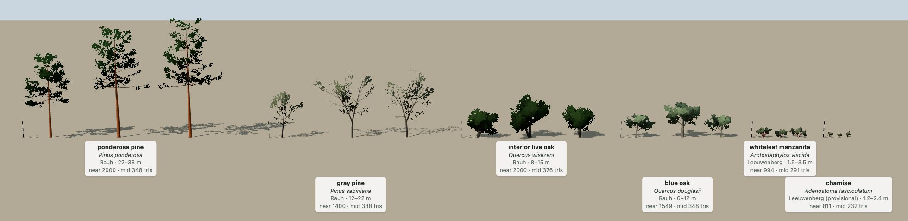
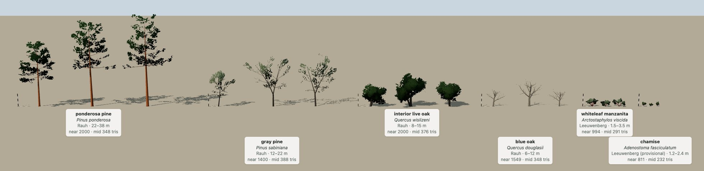

# Species library

Plants are grown, not stored (decision log, 2026-10-23). Each plant species is one
parameter file, `library/species/<id>.json`, written from the species' morphology. The
client grows every tree and shrub from it with a generator in the spirit of Weber and
Penn (1995), *Creation and Rendering of Realistic Trees*. A species written once is
available in every region that has it: this folder is the start of the shared,
community-built species library the [brief](brief.md) calls for. Tiles reference
species by id and never carry plant geometry (see [tile-spec.md](tile-spec.md),
"Species library").

Files: `library/species/index.json` lists the species; one `<id>.json` per species;
`library/embed_builtin.py` copies them into the client as an offline fallback.
Generator: `client/src/treegen.js` (`client/src/trees.js` keeps the older interface).
Review page: `client/lineup.html`.

## Licence

Species parameter files are **CC BY-SA 4.0**. Every file says so in `license`. Credit
contributors in `authors`. Sources you read go in `sources`; record facts and your
reasoning in your own words in `notes`, and never paste text from a source.

## How a tree is grown

1. **Skeleton.** A trunk (level 0, or several stems for shrubs) with a straight bole,
   then curved segments. Branch levels follow: level 1 on the trunk, level 2 on level
   1, and so on. Each level sets how many branches there are, where they sit, their
   angles, length, curvature and taper. Lengths on the trunk follow a crown shape.
   Height is drawn from `height_m` per seed, and the whole tree is scaled so its top
   is exactly at that height.
2. **Foliage.** Leaf cards (two-sided quads with a leaf-spray or needle-tuft texture
   drawn on a canvas for the species) along the outer branches: the deepest level
   from `foliage.start` out, plus the tips of the level above.
3. **Two meshings of the same skeleton**, so the level-of-detail switch changes detail
   and not shape:
   - *near* (within 180 m of the camera): tubes for the trunk and branches, plus leaf
     cards. About 800-2,000 triangles.
   - *mid* (180 m to 1.5 km): trunk and the main limbs as tubes, foliage as a few
     lumpy ellipsoids fitted to the cards by k-means. About 230-390 triangles.
   - Beyond the vegetation radius, the per-cell impostors take over (`impostors.js`).
4. **Season.** The summer colour is baked into the vertex colours. Each season tints
   the species' material by `colors[season] / colors.summer` and drops leaf cards
   above `leaf_on[season]` (each card has a fixed random rank), so a deciduous crown
   thins out and then empties instead of fading.

Placement is not in the file. Habitat class and canopy cover per 30 m cell decide how
many plants a cell holds, and the species mix per habitat decides which
(`client/src/vegetation.js`; later the tile's own mix). Each plant is one of
`variants` seeds, scaled 0.75-1.25 and rotated by a seed from the cell's coordinates.

## Schema

Units: metres and degrees. Colours are sRGB 0-255. Fields left out take the
defaults in `treegen.js` (`DEFAULTS`).

| field | meaning |
|---|---|
| `id` | lowercase scientific name with underscores, e.g. `quercus_douglasii`; the same code tiles use in `species.json` |
| `aliases` | older or short ids that resolve to this species (`blue_oak`) |
| `scientific`, `common` | names as shown on the lineup page |
| `form` | `tree` or `shrub`. For shrubs, `levels[0].count` is per stem and all stems spread |
| `architectural_model` | the Hallé-Oldeman-Tomlinson model, e.g. `Rauh` (oaks, pines), `Leeuwenberg` (manzanita), with "(provisional)" if unsure. Documentation for reviewers; the generator does not read it |
| `deciduous` | true if the crown empties in some season (default: `leaf_on.winter < 0.5`) |
| `height_m` | `[min, max]` mature height in this region |
| `variants` | how many seeds the client builds per species (3) |
| `notes`, `sources`, `authors`, `license` | morphology and reasoning, references, contributors, `"CC BY-SA 4.0"` |

`trunk`:

| field | meaning |
|---|---|
| `length_ratio` | trunk (leader) length / tree height before the final fit. About 1 for pines (excurrent: the leader runs to the top), about 0.5 for oaks (decurrent: it dissolves into limbs) |
| `radius_ratio` | dbh / height |
| `taper` | 0 = cylinder, 1 = cone to a point at the trunk tip |
| `flare` | base radius multiplier (root flare), in the first 0.35 m |
| `bole_ratio` | straight, clear bole as a fraction of trunk length; also where a split happens. The acorn game puts stash holes on it |
| `base_size` | fraction of the trunk bare of level-1 branches (Weber and Penn's BaseSize) |
| `curve_deg`, `curve_var_deg`, `segments` | total bend above the bole, random bend per segment, segments above the bole |
| `lean_deg` | maximum lean of the whole tree |
| `tropism` | per-segment pull toward vertical (optional) |
| `stems` | `[min, max]` stems from the base (multi-trunk trees, shrubs) |
| `stem_spread_deg` | tilt of the extra stems (all stems for shrubs) |
| `split_prob`, `split_count`, `split_angle_deg` | chance the trunk forks at the bole top, into how many leaders, at what angle |
| `bark_rgb`, `twig_rgb` | trunk colour; colour the branches blend to by level |
| `bark_pattern` | `smooth`, `checkered`, `furrowed` or `plates` (vertex-colour pattern on the trunk) |

`crown.shape`: Weber and Penn's shapes for level-1 length along the trunk:
`conical`, `spherical`, `hemispherical`, `cylindrical`, `tapered_cylindrical`,
`flame`, `inverse_conical`, `tend_flame`.

`levels[]`, one object per branch level (two is typical; three is supported):

| field | meaning |
|---|---|
| `count` | level 1: branches per tree (per stem for shrubs). Deeper levels: branches per parent, scaled by the parent's length |
| `whorl` | level 1: branches per whorl (conifers); 0 = spiral |
| `start` | deeper levels: fraction of the parent where branching starts (default 0.15) |
| `down_angle_deg`, `down_angle_var_deg` | angle from the parent; 90 is perpendicular, over 90 droops |
| `down_angle_tip_deg` | optional: the down angle at the top of the trunk (level 1) or the tip of the parent, interpolated |
| `rotation_deg`, `rotation_var_deg` | angle around the parent between successive branches (140 is a spiral); negative alternates left and right by that much, which gives flat sprays |
| `length_ratio`, `length_var` | level 1: times trunk length times crown shape. Deeper: times (parent - 0.6 x offset) |
| `curve_deg`, `curve_var_deg` | bend along the branch, random part |
| `tropism` | per-segment pull up (positive: upswept tips) or down (negative: weeping) |
| `taper`, `radius_ratio` | taper along the branch; base radius / parent radius at the fork |
| `segments` | tube segments at near LOD |

`foliage`:

| field | meaning |
|---|---|
| `type` | `broadleaf`, `needle` or `scale` |
| `leaf_size_m` | one leaf (or needle length); sets the scale of the drawn spray |
| `leaf_shape` | `oval`, `lobed`, `lanceolate` (leaf sprays), `needle_cluster` (tufts at twig ends), `needle_fascicle` (tiny bundled leaves, chamise) |
| `cluster_m` | size of one leaf card, which is a spray of many leaves, not one leaf |
| `density` | cards per metre of bearing branch (capped by `lod.near_tris_budget`) |
| `start`, `parent_start` | where foliage starts on the deepest level, and on the level above (default 0.75: tips only) |
| `orientation` | `outward` (from the crown centre, randomised), `vertical` (held edge-on, manzanita) or `along` (cards contain the twig: needle tufts) |
| `droop` | 0-1, needles hang (gray pine) |
| `crossed` | true adds a second card at right angles (more volume, twice the triangles) |
| `colors` | `{winter, spring, summer, fall}` sRGB; summer is baked, the rest are tints |
| `leaf_on` | `{winter, spring, summer, fall}` 0-1, fraction of cards present |

`lod`:

| field | meaning |
|---|---|
| `near_tris_budget` | target triangles for the near tree; wood first, cards fill the rest (the console warns if wood alone takes over 70%) |
| `near_sides` | tube sides per level at near, e.g. `[7, 5, 3]`; 0 skips the level's geometry (its foliage stays) |
| `mid_blobs` | ellipsoids at mid |
| `mid_branches` | how many level-1 limbs are drawn at mid (longest first) |
| `mid_sides` | tube sides for trunk and limbs at mid (default `[6, 3]`, shrubs `[4, 3]`) |
| `mid_blob_scale` | below 1 shrinks the blobs for open, see-through crowns (gray pine and ponderosa 0.7) |
| `mid_canopy` | `blobs` (default) or `cards`: the mid canopy as about `mid_cards` (60) of the near cards, enlarged to keep the leaf area. See "Known limits" |
| `mid_cards` | cards kept in `cards` mode |

## Writing a species

1. Copy the closest existing file and rename it to the new `id`. Add the id to
   `index.json`.
2. Read species accounts. FEIS (USDA Fire Effects Information System), Jepson eFlora,
   Calflora, USDA PLANTS and Silvics of North America are good for habit, height, dbh,
   bark, leaves and phenology. Look at many photographs of mature trees in the region.
3. Work from the large shape down:
   - height range and dbh (`radius_ratio` = dbh / height);
   - excurrent or decurrent (`trunk.length_ratio`), clear bole, forking, lean, crookedness;
   - crown shape and level-1 angles, length and count;
   - twigs (level 2);
   - foliage size, shape, density and colour by season, and leaf-on by season.
4. Write `notes`: the morphology you used and why each unusual number is what it is
   (e.g. "drought-deciduous, so leaf_on.fall 0.6"). Name the architectural model, and
   mark it provisional if you are not sure.
5. Run `python3 library/embed_builtin.py`, open `client/lineup.html` (dev server:
   `.venv/bin/python server.py`), and iterate.

## Review

A species is accepted when:

1. **Lineup.** On `client/lineup.html`, all three seeds read as the species at a
   glance next to the others and against the 5 m poles; the near and mid LODs match
   in silhouette, density and colour (toggle "mid LOD"); and every season looks right
   (deciduous species bare in winter). The triangle counts on the labels are within
   budget. The page warns if the built-in copy is stale.
2. **In the world.** A low pass at 20 m and a pass at about 150 m over a tile where
   the species grows, in at least two seasons.
3. **Local knowledge sign-off.** Someone who knows the species where it grows (a local
   naturalist, forester, tribal land steward or long-time resident) compares the
   lineup with the trees they know and signs off by adding themselves to `authors`
   with "reviewed" and the date, or flags what is wrong in `notes`. Until then the
   file says "needs local sign-off". The six starter species are agent drafts and are
   all waiting for this.

Reference photographs belong in the review conversation, not in the library.
Link to them; do not copy them into the repository.

## Starter species (Sierra foothills, 2026-10-23)

| id | alias | model | near / mid triangles |
|---|---|---|---|
| `quercus_douglasii` (blue oak) | `blue_oak` | Rauh | 1,354-1,784 / 348 |
| `quercus_wislizeni` (interior live oak) | `live_oak` | Rauh | 2,000 / 360-408 |
| `pinus_sabiniana` (gray pine) | `gray_pine` | Rauh | 1,400 / 348-408 |
| `pinus_ponderosa` (ponderosa pine) | `ponderosa` | Rauh | 2,000 / 348 |
| `arctostaphylos_viscida` (whiteleaf manzanita) | `manzanita` | Leeuwenberg | 982-1,000 / 280-296 |
| `adenostoma_fasciculatum` (chamise) | `chamise` | Leeuwenberg (provisional) | 702-900 / 228-240 |

Counts are per seed (the three variants), with blobs at mid. In `cards` mode the mid
counts are 204-290.

## Known limits

- Leaf cards are sprays, not single leaves: close up (under about 5 m) the spray
  texture is visible, and the alpha-tested edges alias.
- Bark texture and normal map are drawn per species (see "Likeness fields" below) and used within the
  near distance; the mid trunks are plain vertex colour with the same mean.
- Cones and fruit are not drawn. Chamise flower and seed heads are coloured wand tips (`foliage.tips`).
- No wind yet. The skeleton has what wind needs (per-level stems), but nothing animates it.
- Mid-LOD blobs are axis-aligned and lumpy. From 180 m to about 400 m they read as
  clumps of balls, denser and smoother than the near crowns, so the switch at 180 m
  shows as a change in texture even with the dithered cross-fade (±15 m). The
  `cards` mode (`lod.mid_canopy: "cards"`, or `?mid_canopy=cards` on the client URL
  to preview it for all species) hides the switch almost completely and draws fewer
  triangles, but alpha-tested cards cost fill rate: about 50 fps against about 60 at
  the start view on the development Mac (2026-10-23).
- Chaparral cover is sparse: the shrub count per cell was tuned for the old blob
  shrubs and gives about 6% cover where the data says 50-60%. Closing it needs either
  many more instances or a shrub-field layer, not a parameter change.

## Far foliage

Beyond the near distance the generator draws either ellipsoid blobs or about sixty
enlarged leaf cards (`lod.mid_canopy`: `blobs` or `cards`). The default is `cards`:
in side-by-side review (2026-10-24) blobs made the far forest read as a crowd of green
balls while cards kept it continuous, at a cost of roughly ten frames per second on a
laptop. A species file may set `blobs` to buy that back.

## Fields added 2026-10-24

| field | meaning |
|---|---|
| `description` | two sentences for the species card: appearance, where it grows here, one ecological note |
| `season_notes` | one line per season (winter, spring, summer, fall) shown on the card |
| `status` | `agent draft, needs local sign-off` until a resident signs the file off |
| `levels[].droop_deg`, `levels[].upturn_deg` | downward arch of a branch level and the upturn of its tips (ponderosa limbs) |
| `lod.close_factor`, `lod.close_scale` | close tier (within ~70 m): multiplier on leaf-card count and card size relative to the near tier |

## How a tree is grown, addendum

Three tiers now: close (within ~70 m, 3-3.5x the leaf cards at 0.6x size with a leaf
texture drawn at true leaf size, alpha-to-coverage edges), near (to ~240 m) and mid
(beyond, cards or blobs). Tiers hand over with a complementary screen-space dither so
no tree pops. The close tier is empty at altitude and costs nothing there.

## In the client

`client/src/identify.js`: the HUD names the nearest tree and counts species within
100 m four times a second; a click on a tree (not a drag) opens the species card built
from the file; T toggles name tags over one tree in ten within 160 m.

## Likeness fields (2026-10-24)

From the photo comparison in [tree-likeness-review.md](tree-likeness-review.md). Every field is
optional and its default reproduces the tree as it was grown before, so older files are unchanged.

| field | meaning |
|---|---|
| `crown.envelope` | crown outline traced from photographs: `profile` `[[h, r], ...]` (crown radius r at height h, both fractions of tree height), `lobes` and `lobe_depth` (bulges around the crown), `asymmetry` (one heavier side), `fill` (how far a level-1 limb may grow to reach the outline, 0.3 = 30% longer), `edge` (slack for twigs past the outline). Limbs and twigs are shortened (or lengthened, up to `fill`) so their tips land on the outline, Weber and Penn's pruning. Shrub stems are fitted too (the chamise vase) |
| `trunk.split_height` | where the trunk forks, as a fraction of its length; default the bole top. Gray pine forks high |
| `trunk.sinuous_deg`, `levels[].sinuous_deg` | smooth S-bends per segment (manzanita stems) |
| `levels[].zigzag_deg` | alternating turn per segment, the growth-unit zig-zag of oak limbs and twigs |
| `trunk.stubs` | `{ count: [min, max], length_m, radius_ratio }`: short dead stubs on the clear bole (ponderosa) |
| `trunk.bark` | bark texture: `tile_m` [width, height] of one tile in metres, `plate_m` [w, h] of a plate or check, `ridge_m`/`block_m` (furrowed), `fissure` (0-1), `contrast`, `lichen` (0-1), `relief` (normal-map strength). The pattern is `bark_pattern`, now also `shreddy`; `bark_rgb` stays the mean colour |
| `deadwood` | `{ fraction, where: lower / inner / any, levels, shorten, rgb }`: grey dead branches (or shrub stems with `levels: [0]`) without foliage |
| `epiphytes.mistletoe` | `{ prob, count: [min, max], radius_m }`: evergreen balls on the outer limbs, drawn with the wood so they show in a bare crown |
| `foliage.clumps` | `{ radius_m, cards_per_clump, shell, flatten, tip_bias }`: cards gathered into clumps at twig ends with gaps between them; `shell` drops clumps from the inner crown (fraction of the crown radius). Mid cards are then one per clump, sized to its leaf area |
| `foliage.leaf_shape` | adds `oblong_wavy` (blue oak), `elliptic_glossy` (live oak), `round_vertical` (manzanita), `needle_drooping` (gray pine), `needle_brush` (ponderosa), `fascicle_wand` (chamise) |
| `foliage.palette` | `[[weight, [r, g, b]], ...]`: per-leaf tints drawn into the texture (old yellow leaves in live oak) |
| `foliage.tips` | `{ season: [r, g, b] }`: colour of flowers or seed heads at the wand tips (chamise: cream in spring, rust in summer and fall) |
| `foliage.winter_twigs` | for deciduous species, the fraction of cards that show bare zig-zag twigs (coloured `trunk.twig_rgb`) when the crown is leafless |
| `foliage.twist_deg` | needle tufts turned about their twig by up to this much, so a pine crown has volume rather than sheets |
| `foliage.ao_min` | floor of the inner-crown darkening (default 0.62); higher for pale, low-contrast crowns |
| `foliage.color_var`, `foliage.leaf_on_var` | per-plant variation from a hash of the plant's position: `[value, yellow-blue]` colour spread, and how much whole plants leaf out or drop leaves early or late |
| `lod.mid_tex_scale` | size of the mid cards' texture relative to the near card (default 2) |
| `targets` | photo-measured `crown_width_ratio`, `crown_base_ratio`, `porosity`, `foliage_rg`, `foliage_bg` and where they came from. The lineup measures each seed the same way and prints measured / target under the label (green within tolerance); `?metrics=0` turns it off |

`trunkMaterial(patch, spec)` returns the species' bark material; without `spec` it is the
shared plain material as before. `applySeason` also switches card textures (season tips,
winter twigs).

## Frame-cost fields (2026-10-25)

| field | meaning |
|---|---|
| `lod.mid_cards` | cap on far-tier cards per plant after merging interior clumps (default 40 trees, 24 shrubs); the outline keeps its lumps |
| `lod.mid_segments` | segments per branch level in the mid tier (default `[3, 1]`); mid trunks default to 4 sides |
| `lod.mid_branches` | limbs kept in the mid tier (ponderosa 2, gray pine 3, blue oak 4, live oak 2) |

Mid cards thin with distance beyond 300 m: the outer 20% always stay, inner cards fall
to a 25% floor and grow to hold cover. Bark textures draw within 120 m. The lineup can
measure any tier: `__lineupMetrics('mid' | 'close')`, and `__lineupMetrics('mid', 900)`.

## Age classes and snags (2026-10-24)

Phase 2 step 7 of [tree-likeness-review.md](tree-likeness-review.md). A woodland is not one
tree repeated: it has saplings, young trees, mature trees, a few veterans and some dead ones.
`variants` may now be a list of weighted age classes instead of a count, and `snag` adds a
dead tree. A file with `"variants": 3` is grown exactly as before.

| field | meaning |
|---|---|
| `variants` | `[{ name, weight, ... }, ...]`: age classes. Each class is the file plus the overrides below. The class marked `"base": true` (else the one named `mature`, else the heaviest) is the file as written and keeps the old seeds, so its trees, the lineup's measured seeds and every metric are unchanged |
| `variants[].height_m` | the class's height range (replaces the file's) |
| `variants[].trunk_radius` | multiplies `trunk.radius_ratio` (slender saplings, thick veterans) |
| `variants[].crown_scale` | multiplies the crown envelope's radii and the level-1 limb length (broader veterans) |
| `variants[].branches` | multiplies every level's branch `count` |
| `variants[].gnarl` | multiplies curve variance and lean of trunk and limbs, and their zig-zag |
| `variants[].leaf_density` | multiplies `foliage.density` |
| `variants[].deadwood` | a fraction (keeps the file's `deadwood` block, else inner limbs and twigs, levels 1 and 2) or a `deadwood` block merged over the file's: dead limbs without leaves inside a living crown, or grey dead shrub stems with level 0 |
| `variants[].set` | any other fields, merged over the file before the multipliers (objects merge, arrays replace, `levels` merge by index), e.g. a class's own `crown.envelope`, `trunk.bark_rgb` or `lod.near_tris_budget` |
| `variants[].seeds` | distinct trees grown for the class (default 1; mature classes use 2 so half the woodland is not one tree) |
| `variants[].note` | what the class should look like, for reviewers |
| `snag` | `{ fraction, from, height_m, limbs, twigs, levels, broken_top, shorten, rgb, set }`: a dead tree grown as class `from`, then stripped: no foliage or mistletoe, grey wood (`rgb`), branches deeper than `levels` removed except a `twigs` fraction, a `limbs` fraction of level-1 limbs kept (the rest broken to stubs or gone), every kept stem broken back to `shorten` [min, max] of its length, and for conifers the top snapped at `broken_top` [min, max] of the height with a splintered point |

Materials stay per species (leaf texture, bark texture, colours), so a class must not change
`foliage.leaf_shape`, `leaf_size_m`, `cluster_m` or the season colours; geometry and vertex
colour (bark tone, dead wood) may change freely.

**Slots.** Every plant draws one variant slot, `Math.floor(rnd() * VARIANTS)`, exactly where it
always drew its variant, so positions, species and acorn-stash ids do not move.
`VARIANTS = SLOTS = 12` (`treegen.js`), and `variantSlots(id)` hands the slots to the classes
and the snag by largest remainder in proportion to the weights, every class getting at least
one. Shares are therefore in twelfths: a 3% snag becomes 1/12 (8%). Slots of one class cycle
through its `seeds` trees. Vegetation builds one mesh set per distinct tree and points the
slots at them (`veg.meshes[id]`: distinct trees, `veg.slots[id]`: the 12 slots). The far
impostors (`impostors.js`) bake every slot from `variantSeed(id, v)` and draw the same slot per
plant, so a far tree is still its own impostor, snags included. A class tree's seed carries the
class (`(class index + 1) * 0x10000 + 1000 + 17 * copy + id length`); base-class seeds are the
old `1000 + 17 * copy + id length`.

| species | classes (share of plants, height) | snag |
|---|---|---|
| blue oak | sapling 8% (2-4 m), young 17% (5-8 m), mature 50% (file, 6-12 m), veteran 17% (10-14 m: thick, broad, gnarled, dead limbs, more mistletoe) | 8%, from veteran, 8-13 m, keeps 60% of limbs and some twigs, pale grey |
| ponderosa pine | pole 25% (8-15 m: blackjack bark, conical crown to 22% of height), mature 50% (file), old-growth 17% (30-40 m: flat top, clear bole to 62%, pale yellow plates, dead lower limbs) | 8%, from mature, top broken at 55-85%, 30% of limbs |
| gray pine | young 25% (6-12 m: single leaning leader), mature 50% (file), veteran 17% (15-24 m: forked into three, many dead limbs) | 8%, from veteran (forked), 12-20 m, top broken at 70-95% |
| interior live oak | young 25% (4-8 m, one or two stems), mature 58% (file), veteran 17% (11-16 m: two to four heavy stems, some dead limbs) | none (resprouts) |
| whiteleaf manzanita | young 25% (0.7-1.5 m), mature 50% (file), decadent 25% (2-3.5 m: grey dead stems among the red) | none |
| chamise | young 25% (0.6-1.3 m, dense), mature 50% (file), decadent 25% (1.5-2.6 m: half the stems grey) | none |

A snag's canopy holds six zero-size cards along its upper trunk, so its canopy geometry is never
empty: the shadow proxy built from the mid canopy bounds is then a slim spire, not a crown, and
the impostor bake gets a cap height. The near trunk (limbs included) casts the real snag
shadow.

**Lineup.** "all variants" (`?classes=1`) shows one tree per class plus the snag for every
species, labelled with the class, the tree's height, the class range and its share of plants.
The measured layout (three base-class seeds) is unchanged and its metrics are identical.

**Cost** (start view, same pose, A/B against the previous commit): frame rate unchanged (51 fps
both, GPU-bound on the test machine), 169 draw calls instead of 130, triangles 5.8 M instead of
6.1 M (saplings and young trees are smaller), render CPU 0.92 ms instead of 0.85 ms. 28 distinct
trees instead of 18. The impostor atlas holds 72 slots instead of 18: 60 MB with mips instead of
15 MB, and the bake takes about 1.3 s instead of 0.4 s at load.

**Known limits.**
- Shares are twelfths, so the rarest classes are over-represented (snags 8% instead of 3-5%).
  More slots cost atlas memory and bake time linearly (20 slots: 100 MB, about 2.2 s).
- Far impostors beyond about 1.75 km rescale every tree's height into the species' `height_m`
  (the base class's range), so a sapling slot there is stretched taller and a snag gets a
  living tree's height. At that range a tree is a few pixels.
- Acorn-stash holes sit on whichever class the oak is: on a sapling they are low (under 0.5 m)
  on a 3 cm stem, and a snag can hold a stash (acorn woodpeckers do use dead oaks).

## Foliage by crown size (2026-10-24)

Review found that the bigger a tree, the sparser it looked. The old rule (cards per metre of bearing
stem, capped by `lod.near_tris_budget`) gave every tree of a species about the same number of cards,
because nearly every tree hit the budget cap. A veteran spread a sapling's cards over a crown four times
larger, and the mid tier's fixed card cap made it worse. Foliage is now set per square metre of crown.

- **Crown area.** Each tree's crown envelope (`crown.envelope`, after its class's `crown_scale` and the
  height fit) is integrated into a surface area: the lobed surface of revolution plus the disc under
  the crown base.
- **Density.** `foliage.cards_per_m2` sets cards per m² of envelope. Without it, the species' reference
  tree (base class, first seed: the lineup's first measured tree) keeps the card count the old rule
  gave it, and that count over its area is the density. Either way the reference tree stays within
  `lod.near_tris_budget`. A class's `leaf_density` (or its own `foliage.density`) scales the density.
- **Count.** Cards = density × area / s², where s is the card size factor (area ratio)^0.25, clamped
  0.9 to 1.4, so big crowns get somewhat larger cards and the count grows more slowly than the area.
  The card cap is the reference tree's count times 1.5 × the area ratio, clamped 0.15 to 2.5.
  `lod.near_tris_budget` is therefore the reference tree's budget, and a class's own
  `lod.near_tris_budget` is no longer read (live oak's veteran still sets one; it has no effect).
- **Mid tier.** The mid card cap is `lod.mid_cards` times the crown diameter ratio (square root of the
  area ratio), clamped 0.4 to 2.2 (0.7 to 2.2 for shrubs). The far thinning is unchanged.
- `buildTree(...)` also returns `crown: { area_m2, cards_per_m2, card_scale, mid_cap }` for
  inspection. The lineup's `__lineupMetrics('near', 0, 'classes')` measures one tree per class, and
  `__lineupSeeds(id)` gives the metrics of each measured seed.

Gaps (lineup porosity, near tier), smallest to largest class, before and after:

| species | before | after |
|---|---|---|
| ponderosa (pole, mature, old-growth) | 0.39, 0.45, 0.52 | 0.27, 0.35, 0.34 |
| gray pine (young, mature, veteran) | 0.21, 0.28, 0.51 | 0.39, 0.32, 0.40 |
| interior live oak (young, mature, veteran) | 0.06, 0.25, 0.42 | 0.24, 0.25, 0.37 |
| blue oak (sapling, young, mature, veteran) | 0.10, 0.21, 0.27, 0.50 | 0.21, 0.19, 0.24, 0.28 |
| whiteleaf manzanita (young, mature, decadent) | 0.02, 0.37, 0.56 | 0.30, 0.37, 0.42 |
| chamise (young, mature, decadent) | 0.11, 0.34, 0.62 | 0.30, 0.34, 0.51 |

Decadent shrubs and veterans stay a little more open on purpose: they carry dead stems and limbs.
Cost, measured at the start view (same pose, back to back against HEAD): near-set foliage 671,630
triangles against 627,162 (+7%, 637 plants), mid canopies 1.73 M against 1.78 M, all triangles
5.25 M against 5.27 M, and the frame rate the same within noise (two A/B pairs: 82.8/79.0 against
78.8/74.4 fps, then 62.8/64.7 against 66.6/65.1).

## Pine needles (2026-10-24)

Review comment: "Pines seem to have leaves rather than needles." The two pines' cards were large sprays
with many tufts drawn on them. From 20 m they read as flat dark sheets (ponderosa) or leafy clumps
(gray pine), because box-filtered mips turn a one-texel needle into dots and a tuft into a solid lobe.

- **Textures** (`leaf_shape` `needle_brush`, `needle_drooping`; `drawNeedleCard` in `treegen.js`).
  Each card is a branch end seen side-on: a twig from the card's lower edge and a few shoots, each
  carrying needle bundles (fascicles of three). Every needle is projected from 3D (an angle from the
  shoot and an azimuth around it), drawn as a thin five-piece arc, and shaded from a darker base to a
  lighter tip (`foliage.needle_tip`, an RGB multiplier).
  - `needle_brush` (ponderosa): 3-6 upturned shoots side by side, each a bottle-brush of stiff needles
    along its last 1-2 needle lengths, curving forward.
  - `needle_drooping` (gray pine): longer, sparser shoots, each ending in a loose tuft of very long
    needles that arch over and hang (`foliage.droop`).
  - The mid tier's texture (whole-clump cards) is a few large bursts of thick needles whose outer
    needles point out of the clump: round pom-poms for ponderosa, weeping bursts for gray pine.
- **Mips that keep the needles.** Every level down to 16×16 is drawn again from the same needles, at
  least one texel wide. A fixed random subset of needles is left out so that the level's alpha-test
  coverage matches level 0 (up to four passes), and the level's colour is rescaled to level 0's mean
  brightness. A far crown keeps lines rather than lobes, and neither washes out, fills in nor darkens.
  The smallest levels are box-filtered as before. The impostor bake uses the same textures and cards.
- **Cards.** `foliage.needle_planes` (2) crossed planes through the tuft's axis, so the needles read as
  radiating lines from any side. The card's base sits on the branch (`foliage.tuft_base`, default 0.42
  of the card along the axis). The axis fans out by up to `foliage.tuft_spread_deg` and turns up toward
  vertical by `foliage.tuft_up` (0-1). Mid cards use `lod.mid_planes` planes (1 for both pines: a
  second plane doubled the alpha-tested fill of the far forest), centred on their clump.
- **Placement.** Ponderosa foliage is on the outer part of each limb (level-2 `start` 0.5,
  `parent_start` 0.6) in clumps of two cards, so the crown is open inside. Gray pine is sparse
  (`cards_per_m2` 0.83). Ponderosa limbs went from 4 to 3 segments to give the foliage the triangles.

Lineup (mean of the three measured seeds, near tier; target in brackets):

| species | W/H | crown base | gaps | r/g | b/g |
|---|---|---|---|---|---|
| ponderosa | 0.42 → 0.45 (0.40) | 0.46 → 0.45 (0.45) | 0.56 → 0.35 (0.35) | 0.86 → 0.91 (0.95) | 0.45 → 0.48 (0.47) |
| gray pine | 0.55 → 0.57 (0.65) | 0.42 → 0.42 (0.30) | 0.43 → 0.37 (0.40) | 0.89 → 0.89 (0.88) | 0.79 → 0.78 (0.82) |
| blue oak | 1.43 → 1.47 (1.40) | 0.20 → 0.19 (0.15) | 0.27 → 0.21 (0.20) | 0.86 → 0.85 (0.90) | 0.74 → 0.74 (0.78) |

The mid tier now follows the near tier: mid gaps went from 0.56 to 0.41 (ponderosa), 0.49 to 0.36 (gray
pine) and 0.39 to 0.23 (blue oak). Gray pine's narrow W/H and high crown base were already off before
this change; they come from the skeleton, not the foliage.

**Blue oak** (same review: "the canopy is very sparse, seems like eucalyptus"): smaller cards
(`cluster_m` 1.1 → 0.95) with denser sprays (`foliage.leaf_fill`, a multiplier on the scattered leaves,
3.2), a thinner empty shell (0.45 → 0.2), sprays rolled at random in their own plane
(`foliage.roll_deg` 90, default 40) so they do not all hang along drooping twigs, `cards_per_m2` 1.6
(capped by the near budget), and leaf-on 1.0 in summer and 0.85 in fall.

**Known limits.**
- Under about 3 m a pine card is magnified: 256 texels over a 1.1 m close-tier card make needles look
  like broad soft streaks. A 512 close-tier texture with thinner lines would fix it.
- Ponderosa at 20-60 m in low sun still shows some rounded lobes at the crown edge (a dense brush
  minifies to a disc with a fringe), and a backlit crown is very dark. Light passing through the
  needles (`translucency` in the review) is the missing piece.
- Ponderosa colour is a compromise: the photo ratio (r/g 0.95) renders khaki under the warm morning
  sun, so it sits at 0.91.

## Needle light (2026-10-24)

Review after the pine needle pass: sunlit ponderosa between 20 and 60 m "still partly reads as rounded
lobes", backlit crowns are very dark, and gray pine against the sun is darker than the photos. Each card
was lit as one flat leaf with the crown-shaped normal, so a tuft was either fully lit or black; a card's
five or six overlapping brushes made one palmate outline; and every needle edge was darkened by
filtering.

- **Aux texture** (`needleTexture`, `texture.userData.aux`). Every level of a pine card is drawn a
  second time with the same strokes: rgb is each needle's shading normal in the card's frame (its
  outward direction from the shoot, bent 0.6 toward the needle's own direction, so the needles on the
  sunward side of a tuft face the light and those under and behind it do not; hanging gray pine
  needles face more down), alpha is how thin the foliage is around the texel (1 - local cover over
  about 2 cm of a near card). Its mips come from the same draws as the colour mips, so per-needle
  variety survives to the 32 and 16 texel levels that a tuft uses at 30-60 m.
- **Colour bleed.** Canvas leaves empty texels black, and bilinear filtering pulled that black into
  every needle edge: on the small levels, where a needle is one texel wide, most of a needle's
  fragments sample its edge and came out as dark as half its colour. Empty texels now take their covered neighbours' colour (three rings, then the
  mean). Alpha and the alpha-test cover are unchanged. The impostor bake reads the same texture, so it
  gets the same colour; no bake change was needed.
- **Lighting** (`canopyMaterial`, only for cards with an aux texture: the two pines; chamise's
  `fascicle_wand` cards and all broadleaf species are unchanged). The card's frame comes from the
  screen-space derivatives of position and uv (no new attributes, no extra draw calls). Per species:
  - `foliage.needle_normal` (0.55): how much of the needle normal is mixed into the crown normal, for
    the sun and the sky light.
  - `foliage.needle_wrap` (0.35): wrap lighting for the sun, so a tuft facing away is not black.
  - `foliage.translucency` (2.5): with the sun behind the tuft, a forward lobe
    `0.25 b + 0.75 b^4` (b = -view·sun) times the thinness, tinted `foliage.translucency_rgb`
    (default [1, 1.12, 0.55], yellow-green). Shadowed like the sun term, so it lights the needles
    at the edge of a crown, not inside it.
  - `foliage.needle_scatter` (0.15): a weak glow of the whole backlit crown (`b^2`, more at thin
    edges), light scattered on through the foliage, so not shadowed by the crown; cloud shadow
    applies.
  - All of it fades out from 900 to 1500 m, where the impostors (crown normal only) take over. The
    values are uniforms (`material.userData.needleLight`, `.needleScatterK`, `.needleTint`).
  - Ponderosa 0.55 / 0.35 / 2.5 / 0.15. Gray pine 0.65 / 0.6 / 3.5 / 0.3 with a less yellow tint
    [1, 1.06, 0.95] so its b/g stays near the photo.
- **Ponderosa tufts as starbursts** (`drawNeedleCard`, `needle_brush`). Four or five shoots forking
  at 0.55-0.9 rad (was four to six at 0.28-0.63), each with a brush on its last 1.4 needle lengths
  (was 2.2) whose needles spread to square with the shoot within a needle length of the apex. A card
  is a few separate round tufts instead of one fan; the alpha cover of the close texture went from
  0.315 to 0.303.

Lineup, near tier (mean of three seeds; photo target in brackets):

| species | gaps | r/g | b/g |
|---|---|---|---|
| ponderosa | 0.35 → 0.34 (0.35) | 0.91 → 0.90 (0.95) | 0.48 → 0.46 (0.47) |
| gray pine | 0.37 → 0.37 (0.40) | 0.89 → 0.88 (0.88) | 0.78 → 0.77 (0.82) |

W/H and crown base are unchanged; blue oak, live oak, manzanita and chamise are identical. Ponderosa by
class: pole gaps 0.27 → 0.31, mature 0.35, old-growth 0.34. A canopy-only render under the lineup's
light (no shadows) is brighter, not darker: ponderosa front-lit mean +23 %, backlit +85 %; gray pine
+26 % and +186 % (in the world the crown's own shadow keeps the backlit gain to the edges).

Cost: one more texture fetch and the derivative frame per pine fragment. Measured A/B against HEAD on a
heavily loaded machine (load average 10-13): start view 48-57 fps against 48-55; the ponderosa stand
at 40 m 34-50 fps against 46-54, and a synchronous render of that view 23.1 / 23.6 ms against
21.6 / 23.0 ms (best of five), so about 1 ms in a full-screen pine stand.

**Known limits.**
- Gray pine tufts still read as round clumps at 20 m; the photos show long hanging tassels and a hazy
  edge. Its tuft shape (`needle_drooping`) was not changed in this pass.
- A crown's shaded side is still lit only by the sky: shadow maps treat a card as opaque, so a sparse
  gray pine has dark clumps where the real crown is lit through.
- Close up (under about 8 m) a face-on lit tuft is still fairly uniform: a card is flat.
